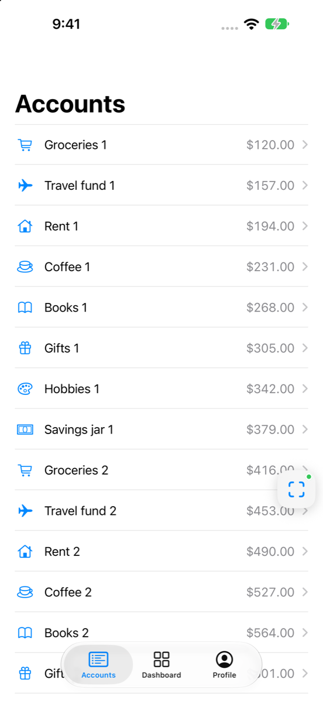
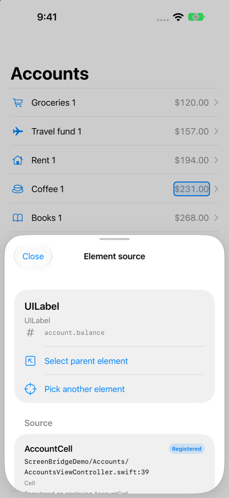
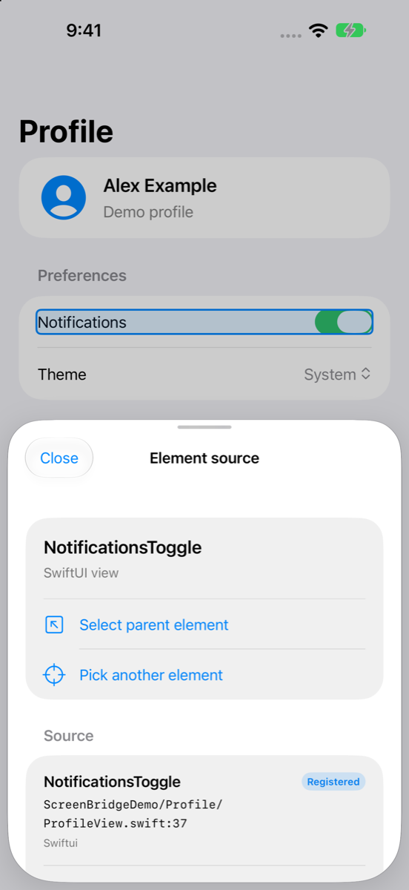
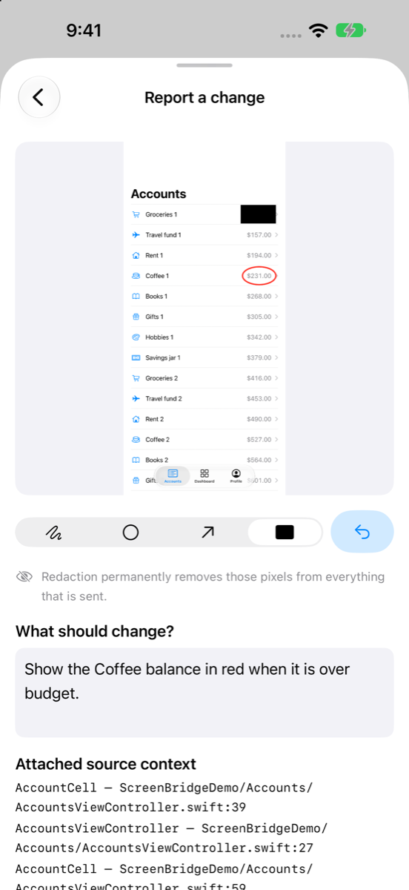

# ScreenBridge Demo

An example iOS app that shows how to integrate [ScreenBridge](https://github.com/MachangDoniel/ScreenBridge), the development-only inspector that maps on-screen UI to registered Swift source, captures annotated screenshots and sends reports to your Mac for Claude.

<table>
  <tr>
    <td align="center"><br><sub>Accounts + floating inspector</sub></td>
    <td align="center"><br><sub>Reusable cell → <code>AccountCell</code></sub></td>
    <td align="center"><br><sub>SwiftUI → <code>ProfileView.swift</code></sub></td>
  </tr>
  <tr>
    <td align="center"><br><sub>Inspector</sub></td>
    <td align="center"><br><sub>Annotate + redact</sub></td>
    <td align="center"><br><sub>Sent to Mac</sub></td>
  </tr>
</table>

| Screen | Demonstrates |
|---|---|
| **Accounts** (`Accounts/AccountsViewController.swift`) | `UITableView` with reusable cells registered per index path (`cell.screenBridgeSource(_:at:in:)`), navigation push |
| **Account detail** (`Accounts/AccountDetailViewController.swift`) | Controller + view registrations, a view model registered from its own file, a modal sheet (`TransferViewController`), an intentionally clipped footnote to report |
| **Dashboard** (`Dashboard/DashboardViewController.swift`) | Custom view-controller containment with two child controllers |
| **Profile** (`Profile/ProfileView.swift`) | SwiftUI `.screenBridgeSource(...)` modifiers inside a `UIHostingController` |
| `App/AppDelegate.swift` | `ScreenBridge.start()` behind `#if DEBUG`, scene-based UIKit lifecycle, `ScreenBridge.log` |

## Run it

1. Install the Mac helper once (from the framework repo):
   ```bash
   git clone https://github.com/MachangDoniel/ScreenBridge.git && ./ScreenBridge/Scripts/install-helper.sh
   ```
2. Open `ScreenBridgeDemo.xcodeproj`. This development checkout uses the sibling `../ScreenBridge` package so local framework changes appear immediately. Keep both folders next to each other.
3. For a physical device, set your Team under **Signing & Capabilities** (and change the bundle ID if needed).
4. Run the **Debug** configuration. The `ScreenBridge Connection` build phase writes the connection file; check the build log for `note: ScreenBridge: configured …`.
5. Tap the floating viewfinder button for the top drawing/selection toolbar. Use **More** for logs and source details, then **Send to Claude** to choose evidence and a destination (Claude Code is the default). Allow Local Network access on the first run on a device.

## What the integration needs (already done here)

- Package dependency on the `ScreenBridge` product.
- **Run Script phase** placed last, `basedOnDependencyAnalysis: false`, output file `$(TARGET_BUILD_DIR)/$(UNLOCALIZED_RESOURCES_FOLDER_PATH)/ScreenBridgeConnection.json`, and `ENABLE_USER_SCRIPT_SANDBOXING = NO`. See `project.yml`.
- Info.plist: `NSLocalNetworkUsageDescription` and `NSBonjourServices = [_screenbridge._tcp]`.

## Verify Release builds stay clean

```bash
./Scripts/verify-release.sh
```

This archives the app in Release (unsigned) and fails if the bundle contains the connection file, ScreenBridge code or strings, or absolute source paths.

## Project generation

`ScreenBridgeDemo.xcodeproj` is generated from `project.yml` with [XcodeGen](https://github.com/yonaskolb/XcodeGen) and committed so you can open it directly. After editing `project.yml`, run `xcodegen generate`. The package currently uses `path: ../ScreenBridge` for local development. To distribute the demo independently, switch that entry to the GitHub URL and a released version that includes the floating workspace, then regenerate. The checked-in signing team matches the existing local Xcode project.
